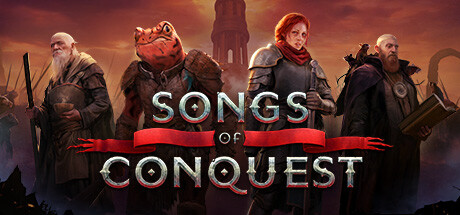

**Songs of Conquest is a turn-based strategy game inspired by Heroes of Might and Magic, featuring warlords called Wielders leading armies of unique creatures across beautiful pixelart maps. Features a deep spell system tied to creature composition.**

---

## 📖 About

Songs of Conquest is a turn-based strategy game inspired by Heroes of Might and Magic, featuring warlords called Wielders leading armies of unique creatures across beautiful pixelart maps. Features a deep spell system tied to creature composition.

## ⚠️ Problems Without Trainer

| Problem | Status |
|---------|--------|
| **Mana Generation** — Wielder spellcasting depends on creature types in army composition | ✅ Solved |
| **Early Game Resources** — Slow resource accumulation in early turns limits build options | ✅ Solved |
| **Hero Death** — Losing your Wielder in combat can instantly end a map | ✅ Solved |
| **AI Aggression** — Computer opponents can outmaneuver players who expand too slowly | ✅ Solved |

## ✅ Solution

The **Songs of Conquest Trainer** solves all these issues by giving you complete control over the game.

## 🎯 Full Feature List

- Unlimited Resources
- God Mode / Invincibility
- Instant Skill Cooldown
- One-Hit Kill
- Freeze Game Timer
- Unlock All Items & Achievements
- Custom Speed Multiplier
- Save State Anywhere

## 🚀 Quick Start

1. **Disable Windows Defender** temporarily (trainer may trigger false positive)
2. Download the trainer from the button above
3. Launch Songs of Conquest
4. Run the trainer as Administrator
5. Activate desired cheats with hotkeys

## 💎 Free vs Paid

| Feature | Free | Pro |
|---------|------|-----|
| Basic God Mode | ✅ | ✅ |
| Unlimited Resources | ✅ | ✅ |
| All Advanced Cheats | ❌ | ✅ |
| Auto-Updates | ❌ | ✅ |
| Priority Support | ❌ | ✅ |

## 💻 Requirements

- Windows 10/11 (64-bit)
- Songs of Conquest (any version)
- .NET Framework 4.8+
- DirectX 11+

## 🍎 macOS

macOS users can use our alternative tool:

## ⚖️ Legal

This trainer is for educational and single-player use only. Use responsibly.

---

